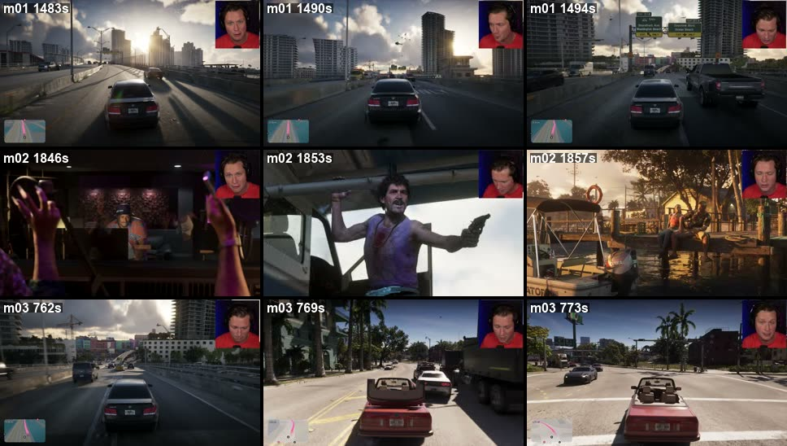
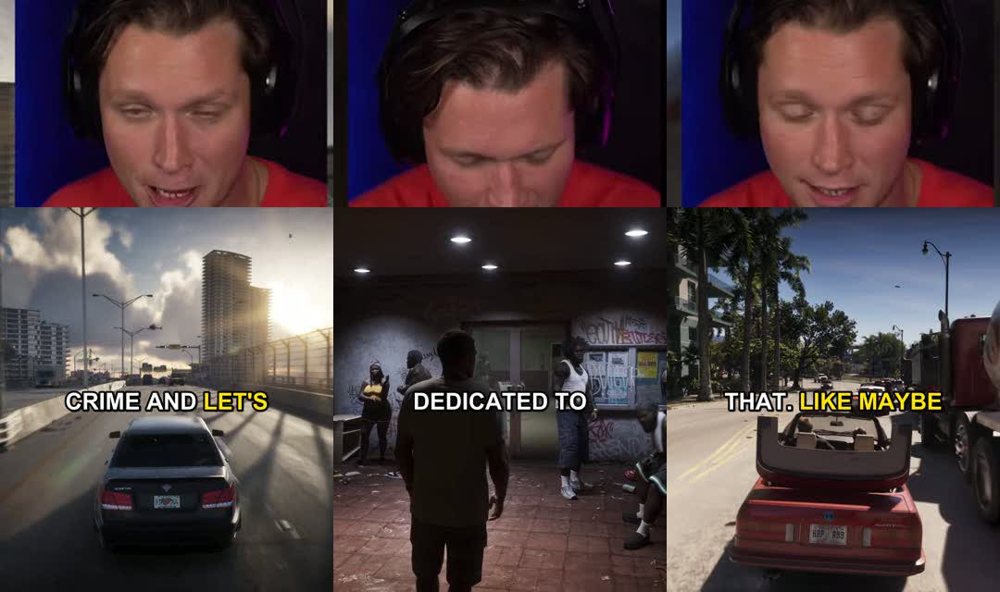
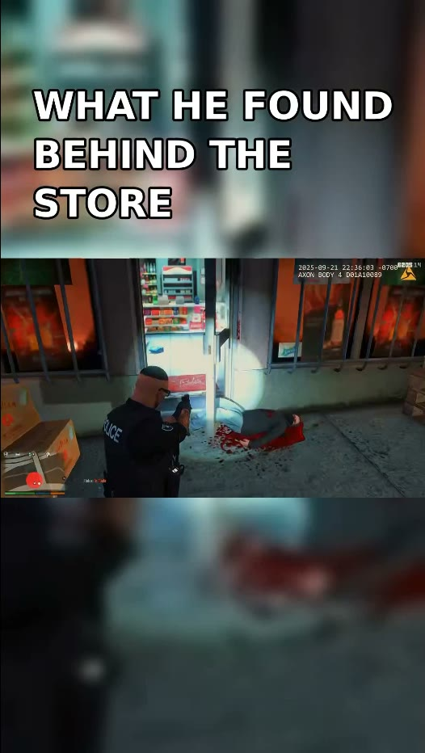
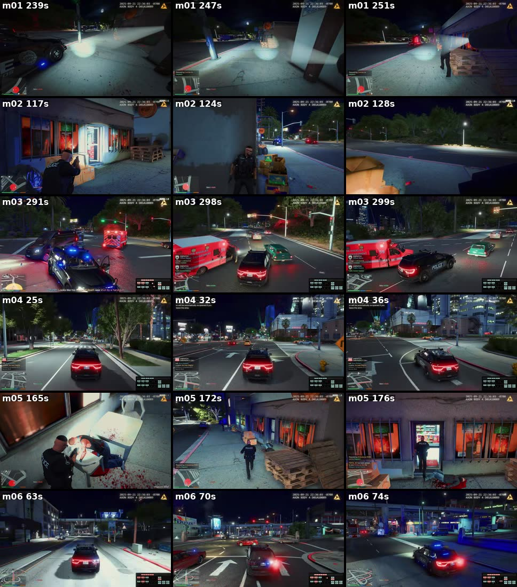

<div align="center">

# ✂️ EasyClip

**Turn [Claude Code](https://www.anthropic.com/claude-code) or [Claude Desktop](https://claude.ai/download) into a Shorts machine.**

Any long video - streams, gameplay, podcasts, vlogs - into vertical clips. ffmpeg does the video work on your computer; Claude never sees a frame.

[](#install-2-minutes)
[](https://github.com/sushant049/easyclip/releases/latest)
[](#whats-in-the-free-edition)
[](skills)
[](https://github.com/sushant049/easyclip/releases/latest)
[](LICENSE)

[](https://ffmpeg.org)
[](https://github.com/sushant049/easyclip/stargazers)
[](https://x.com/sushantkr49)
[](https://dodo.pe/easyclip-pro-sushantkr49)

*"Paste a LINK → Claude finds the MOMENTS → You post the SHORTS"*

</div>

```
> clip https://youtube.com/watch?v=... from 12:00 to 30:00 and make shorts from the best moments
```

<!-- DEMO: replace with your 30-second demo GIF -->

### From a full stream to ready-to-post clips
| The full stream: moments EasyClip picked | The clips it made |
|---|---|
|  |  |

*Facecam layout and word-by-word captions are [Pro](#-easyclip-pro) features.*

[](https://dodo.pe/easyclip-pro-sushantkr49)

### Why it's different
- **Your video never goes to the AI.** ffmpeg analyses it on your computer; Claude reads a 5-line table. A 2-hour stream costs about as many tokens as a chat message.
- **Picks include the buildup**, not just the loud bit - a few seconds of lead-in before every payoff.
- **Policy check before you post:** flags cutscenes/film footage, spoiler titles, music and permission traps.
- **Works with links or files.** YouTube, Twitch, Kick, or anything on your disk.

## Install (2 minutes)

**Claude Desktop - one click**
1. Install `uv` once: Windows `winget install astral-sh.uv` · macOS `brew install uv` · Linux `curl -LsSf https://astral.sh/uv/install.sh | sh`
2. Download `easyclip-0.5.0.mcpb` from [Releases](../../releases) and double-click it.
3. In a new chat: *"run doctor, then clip <link> from 0:00 to 10:00"*.

**Claude Code - skills plugin**
```
/plugin marketplace add sushant049/easyclip
/plugin install easyclip@easyclip
```
Needs ffmpeg + yt-dlp: run `setup.ps1` (Windows) or `bash setup.sh` (macOS/Linux).

**Claude Code - MCP:** `claude mcp add easyclip -- uv run --directory /path/to/easyclip/mcp src/server.py`

## What's in the free edition
| Tool | Does |
|---|---|
| `analyze` | File or link → duration, loudness curve, scene cuts, cutscene detection (cached) |
| `find_moments` | Top 3 highlights with lead-in |
| `make_clip` | One 1080x1920 clip: blur or crop layout, hook text, loudness normalised |
| `policy_check` | PASS / WARN / BLOCK before posting |
| `doctor` | Checks your setup and tells you the exact fix |



*A free-edition clip: blur layout and hook text, 1080x1920.*

## ⚡ EasyClip Pro
For creators and clippers posting every day.

| | Free | **Pro** |
|---|---|---|
| Highlight moments | top 3 | **unlimited** |
| Clips | one at a time | **batch - many clips, one request** |
| Layouts | blur, crop | + **facecam / speaker on top** |
| **Sentence-snapped clips** - never start mid-word | | ✓ |
| **Transcript re-rank** - Claude judges what's said, not pixels | | ✓ |
| **YouTube live-chat spikes** - the moments chat went crazy | | ✓ |
| **Animated word-by-word captions** | | ✓ |
| **Recaps**: dead air + um/uh removed, YouTube chapters | | ✓ |
| **Thumbnails** | | ✓ |
| Presets: gaming, podcast, tutorial | | ✓ |
| Token report: proof of cost per clip | | ✓ |
| Preview image before you render | | ✓ |
| Saved channel settings | | ✓ |

### What Pro adds
- **Batch clips** - ask once, get a vertical clip for every moment you pick, each with its own hook.
- **Facecam layout** - your camera or the speaker stacked on top, gameplay or screen below.
- **Sentence-snapped clips** - start and end points move to sentence boundaries, so a clip opens on "Okay..." and ends right after the punchline, never mid-word.
- **Transcript re-rank** - Claude reads only the words around each candidate (about 1-2k tokens, no frames) and re-orders moments by what was actually said.
- **YouTube live-chat spikes** - downloads the stream's chat replay and boosts moments where chat exploded.
- **Animated captions** - word-by-word captions burned into the clip, styled for Shorts, Reels and TikTok.
- **Recaps with chapters** - stitches the best parts into a longer recap, cuts dead air and "um"/"uh" filler, and writes YouTube chapter timestamps.
- **Thumbnails** - picks the sharpest frame near the peak, boosts colour and adds a bold title, 1280x720 ready for upload.
- **Presets** - tuned scoring for gaming, podcast, tutorial (screen recordings) and general footage.
- **Preview image** - a contact sheet of the picks so you can approve before rendering.

  

- **Saved channel settings** - remembers your layout, hook style, caption style and preset per channel.
- **Token report** - shows exactly how many tokens each clip cost.
- **Policy check** - the same PASS / WARN / BLOCK check, which Claude runs for each clip it cuts.

12 MCP tools and 10 skills. Single-user license, up to 3 computers.

[](https://dodo.pe/easyclip-pro-sushantkr49)

One-time payment, 12 months of updates. **[Get EasyClip Pro →](https://dodo.pe/easyclip-pro-sushantkr49)**

## CLI
Everything the AI does, you can run yourself: `python3 scripts/ch.py doctor | analyze | moments | reel | policy` (Windows: `python scripts\ch.py ...`).

## Fair use
Clip content you own or have permission to clip. The policy check is a heuristic, not legal advice.

MIT licensed. If EasyClip saved you time, ⭐ the repo and tag your clips **#EasyClip**.

## Star History

<a href="https://www.star-history.com/?repos=sushant049%2Feasyclip&type=timeline&legend=bottom-right">
 <picture>
   <source media="(prefers-color-scheme: dark)" srcset="https://api.star-history.com/chart?repos=sushant049/easyclip&type=timeline&theme=dark&legend=bottom-right" />
   <source media="(prefers-color-scheme: light)" srcset="https://api.star-history.com/chart?repos=sushant049/easyclip&type=timeline&legend=bottom-right" />
   
 </picture>
</a>

## About the author
[](https://www.linkedin.com/in/sushant-k28/)

[LinkedIn](https://www.linkedin.com/in/sushant-k28/) · [X @sushantkr49](https://x.com/sushantkr49)
